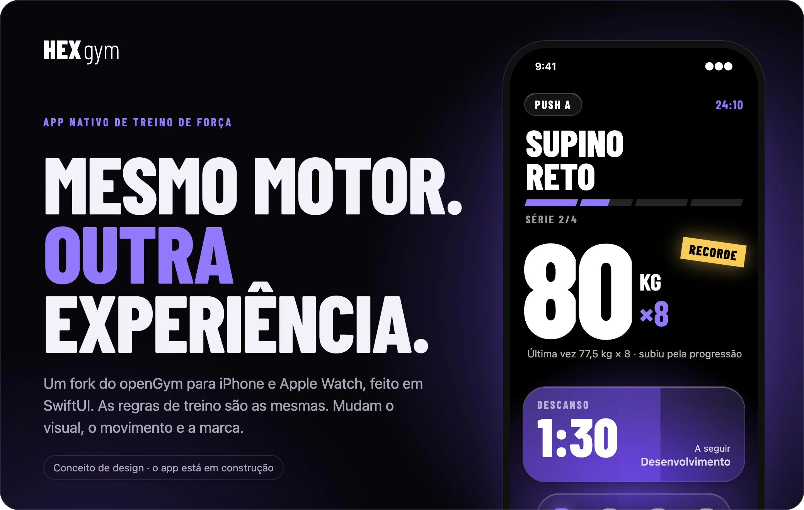
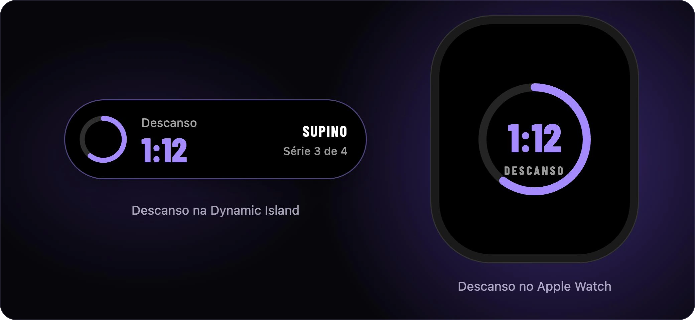
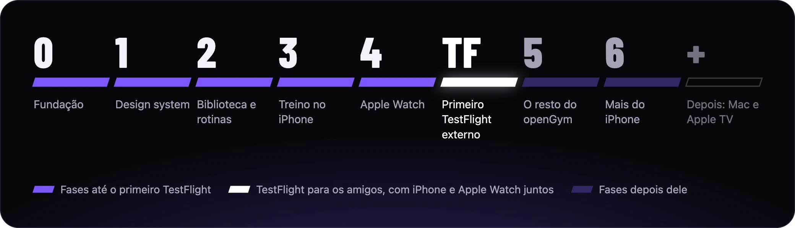

<h1 align="center">
  
</h1>

  App nativo de treino de força para iPhone e Apple Watch, feito em SwiftUI.

  <a href="https://github.com/DuarteSantos8/openGym">Fork do openGym</a> ·
  <a href="https://github.com/lipedesign/HexGym/milestones">As fases</a> ·
  <a href="https://github.com/lipedesign/HexGym/blob/develop/docs/superpowers/specs/2026-10-31-hexgym-native-app-design.md">Documento de design</a> ·
  <a href="https://github.com/lipedesign/HexGym/blob/develop/LICENSE">Licença AGPL-3.0</a>

> [!NOTE]
> Em construção. A fundação (fase 0) e o design system (fase 1) estão em andamento, e ainda não há app para baixar. As imagens desta página mostram o conceito de design, feito em HTML, e não o app rodando.

## O que é

O HexGym é um fork do [openGym](https://github.com/DuarteSantos8/openGym), o app open source de treino de força. Ele segue as mesmas regras de treino do openGym (exercícios, progressão de carga, 1RM estimado, recuperação e sincronização), guarda os dados no mesmo formato e recebe as melhorias quando o openGym evolui. O que muda é a experiência: as telas, o movimento, o Apple Watch, os widgets e os recursos nativos do iPhone.

## A cara do app

Quatro temas para a mesma tela inicial, com o Ultravioleta como padrão. Em todos eles, três cores têm papel fixo: o recorde é sempre ouro, o erro é sempre vermelho, e o esforço aparece sempre com número, não só com cor.

O descanso entre as séries vai aparecer também fora do app, na Dynamic Island do iPhone e no Apple Watch.

## As fases

Cada fase é um marco no GitHub e termina numa versão. O primeiro TestFlight externo, para os amigos, leva o iPhone e o Apple Watch juntos.

| Fase | O que entra | Estado |
| --- | --- | --- |
| [0. Fundação](https://github.com/lipedesign/HexGym/milestone/1) | O repositório e o jeito de trabalhar, o projeto do Xcode e o motor do openGym rodando no iPhone, ainda sem telas | Em andamento |
| [1. Design system](https://github.com/lipedesign/HexGym/milestone/2) | As cores dos quatro temas, tipografia, espaçamento, movimento e vibrações, os componentes próprios e uma galeria dentro do app | Em andamento |
| [2. Biblioteca e rotinas](https://github.com/lipedesign/HexGym/milestone/3) | A primeira abertura, os 5.632 exercícios com busca, filtros e arte própria, e a criação de rotinas e planos | A fazer |
| [3. Treino no iPhone](https://github.com/lipedesign/HexGym/milestone/4) | A tela inicial, o treino com séries, carga e descanso, a Live Activity na Dynamic Island, o recorde, a progressão e o histórico | A fazer |
| [4. Apple Watch](https://github.com/lipedesign/HexGym/milestone/5) | O treino pelo pulso, com o anel de descanso, as complicações e o treino longe do iPhone | A fazer |
| [Primeiro TestFlight externo](https://github.com/lipedesign/HexGym/milestone/6) | iPhone e Apple Watch juntos, para os amigos | A fazer |
| [5. O resto do openGym](https://github.com/lipedesign/HexGym/milestone/7) | Peso e medidas, gráficos, mapa muscular e recuperação, importação, backup e a sincronização com um servidor openGym | A fazer |
| [6. Mais do iPhone](https://github.com/lipedesign/HexGym/milestone/8) | Widgets interativos, Central de Controle, botão de Ação, Spotlight e Atalhos | A fazer |
| Depois | Mac, Apple TV e outras integrações | Sem data |

## Como é feito

- O app é escrito em SwiftUI. As regras de treino continuam em JavaScript, em `frontend/src/lib`, como no openGym: um script junta esses módulos num arquivo só, o HexEngine, que o app vai rodar pelo JavaScriptCore. Assim os dois apps usam o mesmo código e os mesmos testes, e as atualizações do openGym chegam junto.
- O trabalho anda por issues, com um [marco por fase](https://github.com/lipedesign/HexGym/milestones), e segue o Git Flow: tudo entra na `develop` por pull request, e cada fase termina numa versão na `main`.
- O código é escrito com o [Claude Code](https://claude.com/claude-code) e o plugin [relentless](https://github.com/marcelusfernandes/relentless). Cada pull request passa por QA e por uma revisão isolada antes do merge, e as decisões que duram ficam em [`docs/decisions`](https://github.com/lipedesign/HexGym/tree/develop/docs/decisions).
- O [documento de design](https://github.com/lipedesign/HexGym/blob/develop/docs/superpowers/specs/2026-10-31-hexgym-native-app-design.md) diz o que o HexGym vai ser, as fases e as decisões tomadas até aqui.
- A marca usa a fonte [Barlow Condensed](https://fonts.google.com/specimen/Barlow+Condensed), sob a SIL Open Font License 1.1.

## Licença

O código segue a licença do openGym, a AGPL-3.0 ([LICENSE](https://github.com/lipedesign/HexGym/blob/develop/LICENSE)). O [NOTICE.md](https://github.com/lipedesign/HexGym/blob/develop/NOTICE.md) traz uma permissão extra (seção 7 da AGPL) para distribuir o app do openGym por lojas como a App Store, desde que o código-fonte continue disponível sob a AGPL.

As fotos e as animações dos exercícios são licenciadas pela Gym visual ao openGym e ficam fora da AGPL. O NOTICE.md permite que um fork não comercial mantenha as versões de 180 px, sem modificação e com o aviso dele, e é só isso que este repositório guarda. As mídias não podem ser usadas para treinar sistemas de IA, alimentá-los ou fazer pedidos a eles, nem como base para gerar imagens, animações ou vídeos. Qualquer outro uso exige licença própria da [Gym visual](https://gymvisual.com/).
