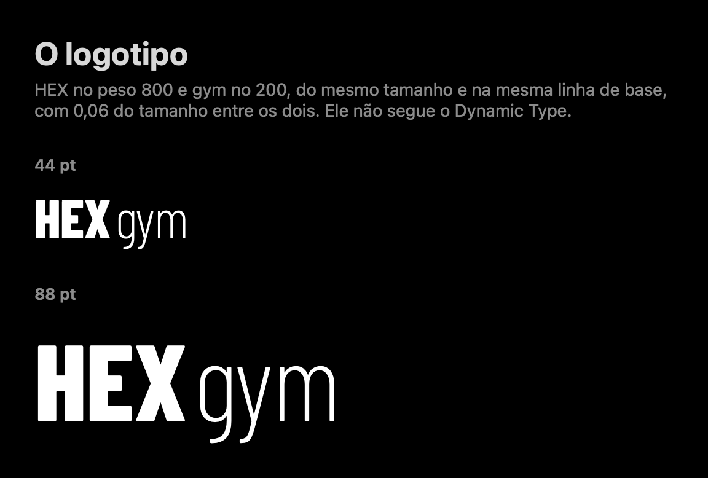
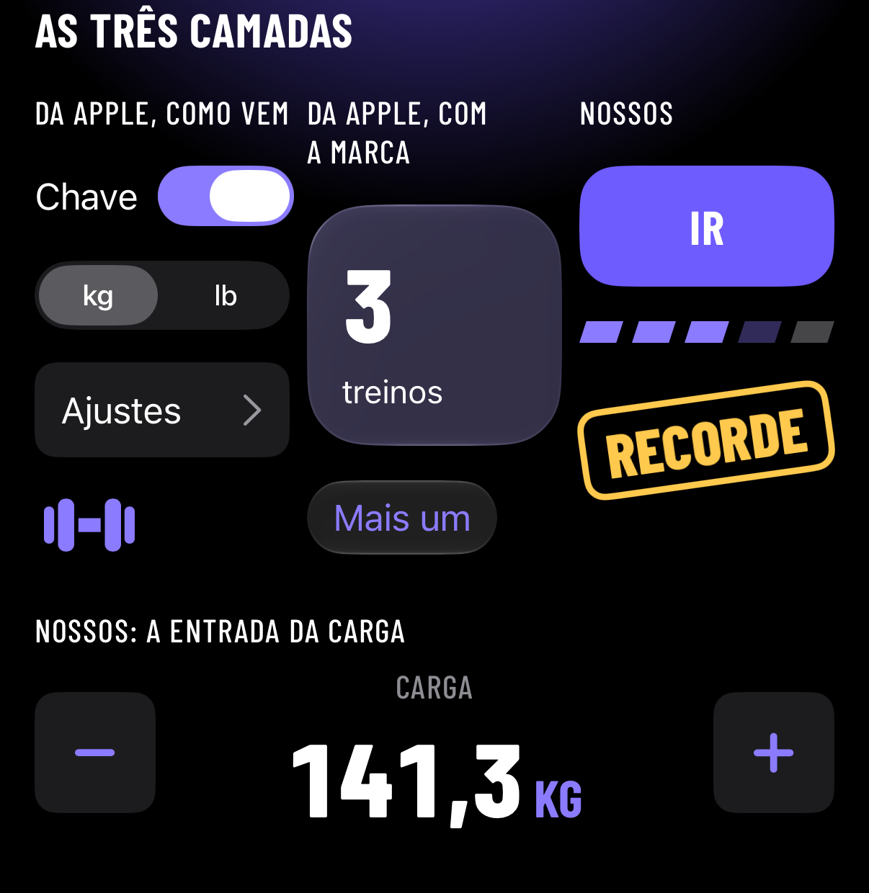
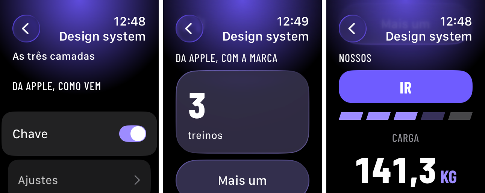
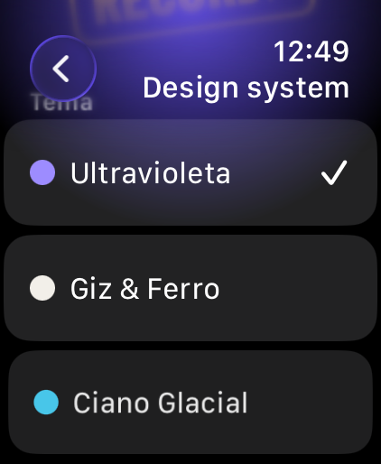

# HexDesign, o design system do HexGym

O HexDesign é o design system do HexGym num pacote Swift: as cores dos quatro temas, a tipografia, o espaçamento, o movimento, os hápticos e os componentes, para o iPhone e para o Apple Watch. Ele vem antes das telas e é documentado em público, como a seção 6 do [documento de design](../../superpowers/specs/2026-10-31-hexgym-native-app-design.md) pede.



## O pacote

- **Onde fica:** `apple/Packages/HexDesign`, um pacote local (seção 8.7 do documento de design).
- **Plataformas:** iOS 26 e watchOS 26. O macOS 26 está no `Package.swift` só para o `swift test` rodar no Mac.
- **O que usa:** SwiftUI, CoreText e Foundation. Nenhum pacote de terceiros. A Barlow Condensed vai dentro do pacote como recurso, com a licença dela (veja [tipografia.md](tipografia.md)).
- **O que não faz:** o pacote não importa o motor (`HexEngine`) nem os dados (`HexStore`). Os componentes só mostram valores e repassam toques. Quem decide o passo da carga e do esforço é o motor, com as regras do openGym.
- **Idiomas:** os textos do pacote saem em português do Brasil e em inglês. Português de qualquer região lê o `pt-BR.lproj`, e os outros idiomas leem o `en.lproj`.

## As três camadas

O sistema é híbrido: parte é da Apple, parte é nossa. A divisão abaixo é a tabela da seção 6 do documento de design com os quatro ajustes das decisões visuais de 03/11/2026: o número que rola e a transição de "Começar treino" passaram para "Da Apple, com a marca"; os botões secundários usam o vidro da Apple tingido pelo tema; e o brilho que respira entrou como nosso.

| Camada | O que é | O que entra nela |
|---|---|---|
| **Da Apple, como vem** | Componente do sistema, com o comportamento do sistema. A marca entra só pela cor de destaque e pela tipografia, onde a Apple deixa | navegação e transições, barra de abas, telas que sobem de baixo, menus, alertas, chaves liga e desliga, seletores, listas de ajustes, busca, ações de deslizar, SF Symbols |
| **Da Apple, com a marca** | O material ou a estrutura é da Apple; o HexGym define cor, tipografia e composição | o cartão de vidro (Liquid Glass) tingido pelo tema, os botões secundários (o `.glass` tingido), o número que rola (o `numericText` da Apple), a transição de "Começar treino" (o zoom da Apple), a escala de texto da marca sobre o Dynamic Type, widgets, Live Activity e complicações |
| **Nossos** | Desenhados e construídos pelo HexGym | o botão principal e suas variações, as entradas do treino (carga, repetições e esforço), os segmentos inclinados, o carimbo de recorde, o anel de descanso e o brilho que respira |

A regra para decidir: se a Apple oferece o componente e o usuário espera o comportamento do sistema, ele é da Apple. Vira nosso só quando é parte da identidade do HexGym, ou quando o do sistema não serve ao treino (por exemplo, registrar a carga com uma mão, entre séries, com pressa). Nosso não é imitação: barra de abas, telas que sobem de baixo e vidro continuam sendo os da Apple.

Todo componente nosso funciona com Dynamic Type, VoiceOver, Reduzir Movimento, Aumentar Contraste, Reduzir Transparência, Texto em Negrito e hápticos, e tem alvo de toque de pelo menos 44 pt.

No app do iPhone, a galeria do design system mostra as três camadas lado a lado, no topo (o botão "Galeria do design system" da tela provisória). Nos tamanhos de acessibilidade, elas viram uma embaixo da outra.



No app do Watch, a galeria do design system abre pelo botão "Galeria" da tela de início. É uma lista, na ordem: as três camadas, uma embaixo da outra; o tema, com o seletor do próprio Watch e a prévia de alto contraste; e os componentes, um por seção. O tema escolhido no Watch fica no App Group, na chave `hexgym.theme`, como no iPhone; na fase 4, ele passa a vir do iPhone. A galeria do Watch em lista, nessa ordem, é uma escolha recomendada, com a delegação do Lipe de 03/11/2026.





No Watch, o app põe o tint branco na raiz, como no iPhone, e as chaves liga e desliga ficam no destaque do tema. Os componentes ficam sobre o preto, sem o fundo cinza das linhas da lista, porque o texto na cor do tema só fica sobre o fundo da tela e sobre o cartão do sistema. O título da galeria fica em branco: o cinza do título do sistema mediu 2,9:1 sobre o brilho. São escolhas recomendadas, com a delegação do Lipe de 03/11/2026.

## Como usar o pacote num alvo

1. No projeto do Xcode, o alvo (o app do iPhone, o do Watch ou um widget) ganha o pacote local `apple/Packages/HexDesign` e o produto `HexDesign`.
2. O arquivo que usa o pacote começa com `import HexDesign`.
3. Na raiz das views, `.hexTheme(model)` põe o tema do aparelho no ambiente. O `ThemeModel` lê e grava o tema nos `UserDefaults` do App Group, e a troca aparece na hora em todas as views abaixo.
4. Nas views, `.hexFont(_:)` dá a tipografia da marca, `.buttonStyle(.hexPrimary)` dá o botão principal, e `@Environment(\.hexPalette)` dá as cores do tema no esquema e no contraste do aparelho.

```swift
import SwiftUI
import HexDesign

@main
struct HexGymApp: App {
  @State private var theme = ThemeModel(store: .appGroupStore())

  var body: some Scene {
    WindowGroup {
      TreinoView()
        .hexTheme(theme)   // na raiz: o tema e a prévia de alto contraste vão para o ambiente
    }
  }
}

struct TreinoView: View {
  @Environment(\.hexPalette) private var palette

  var body: some View {
    VStack(spacing: HexSpacing.l) {
      Text(verbatim: "142,5").hexFont(.number)
      Text(verbatim: "kg").hexFont(.unit).foregroundStyle(Color(palette.accent))
      Button("Começar treino") {}
        .buttonStyle(.hexPrimary)            // ou .hexPrimary(size: .large)
    }
    .padding(HexSpacing.m)
    .background { BreathingGlow() }          // o fundo preto com o brilho do tema
  }
}
```

Duas coisas para saber:

- Com `import HexDesign`, escreva `Color.white` e `Color.black`, e não `Color(.white)` nem `Color(.black)`: o `HexRGB.white` e o `HexRGB.black` do pacote deixam essas formas ambíguas (veja [cores.md](cores.md)).
- As fontes da Barlow são registradas no processo na primeira vez que o pacote pede uma fonte. Não precisa chamar nada antes; o `HexFonts.register()` existe e pode ser chamado mais de uma vez.

## Os testes e as imagens

O pacote tem os próprios testes, em Swift Testing, e a parte `packages` do `node scripts/hexgym/check.mjs` roda todos eles. Para rodar só o pacote:

```bash
DEVELOPER_DIR=$(node scripts/hexgym/xcode.mjs --swift) swift test $(node scripts/hexgym/xcode.mjs --swift-test-flags) --package-path apple/Packages/HexDesign
```

As imagens desta pasta saem dos testes de print do pacote, que só rodam com `HEXDESIGN_PRINTS` no ambiente. Para gerar de novo:

```bash
HEXDESIGN_PRINTS=$PWD/docs/hexgym/design-system/imagens DEVELOPER_DIR=$(node scripts/hexgym/xcode.mjs --swift) swift test $(node scripts/hexgym/xcode.mjs --swift-test-flags) --package-path apple/Packages/HexDesign --filter print
```

Os prints saem iguais byte a byte de uma geração para outra. As imagens que começam com `simulador-` e `watch-` não saem dos testes: são prints dos simuladores do iPhone e do Watch, tirados com a galeria aberta. Nenhuma imagem desta documentação tem mídia de exercício.

## Os outros arquivos

- [cores.md](cores.md): os quatro temas, o alto contraste, o claro, o Watch e a ilha, as regras de contraste e onde o texto na cor do tema pode ficar.
- [tipografia.md](tipografia.md): a Barlow Condensed, a reserva para outras escritas, a escala, os dígitos tabulares, os tetos, o Texto em Negrito, o logotipo e a licença.
- [movimento-e-haptico.md](movimento-e-haptico.md): os movimentos, os hápticos e o que muda com Reduzir Movimento, Reduzir Transparência e Aumentar Contraste.
- [componentes.md](componentes.md): as medidas comuns e cada componente, nosso ou da Apple com a marca, com os estados, o VoiceOver e o print.
