# Os componentes

Cada componente do HexDesign, com o que faz, os estados, o que o VoiceOver diz, a versão do Watch e o print. Primeiro os nossos, depois os da Apple com a marca. As camadas estão explicadas no [README](README.md#as-três-camadas); o que muda com os ajustes de acessibilidade, em [movimento-e-haptico.md](movimento-e-haptico.md); a escala de texto (`.hexFont`) e o logotipo, em [tipografia.md](tipografia.md).

Os componentes leem as cores do tema no ambiente (`@Environment(\.hexPalette)`), então a raiz das views precisa do `.hexTheme(model)`. Eles só mostram valores e repassam toques: o passo da carga e do esforço é do motor, não daqui.

## As medidas comuns

No código: `Layout/HexLayout.swift`. São escolhas recomendadas, com a delegação do Lipe de 03/11/2026.

| Espaço | Valor | | Raio | Valor |
|---|---|---|---|---|
| `HexSpacing.xxs` | 4 pt | | `HexRadius.chip` | 10 pt |
| `HexSpacing.xs` | 8 pt | | `HexRadius.button` | 18 pt |
| `HexSpacing.s` | 12 pt | | `HexRadius.card` | 28 pt |
| `HexSpacing.m` | 16 pt | | | |
| `HexSpacing.l` | 24 pt | | | |
| `HexSpacing.xl` | 32 pt | | | |
| `HexSpacing.xxl` | 48 pt | | | |

O alvo de toque nunca fica abaixo de 44 pt (`HexTarget.minimum`), no iPhone e no Watch.

## Nossos

### O botão principal

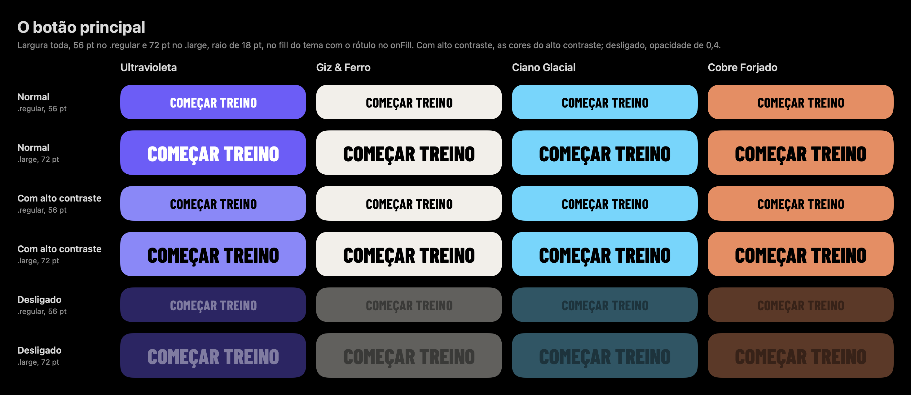

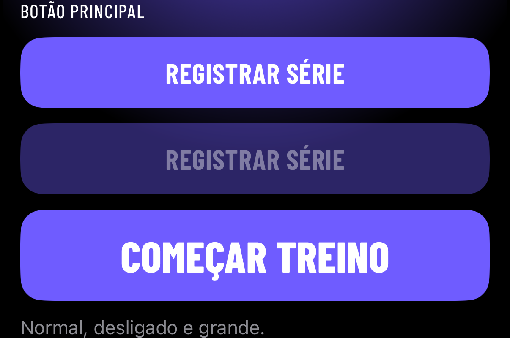

**O que faz:** o botão da ação principal da tela, como "Começar treino". Ocupa a largura toda, no `fill` do tema, com o rótulo no `onFill`.

```swift
Button("Começar treino") {}.buttonStyle(.hexPrimary)
Button("Começar treino") {}.buttonStyle(.hexPrimary(size: .large))
```

- **Tamanhos:** `.regular`, com altura mínima de 56 pt e rótulo no `headline`; e `.large`, com 72 pt e rótulo no `title`. Os dois passam do alvo mínimo de 44 pt. Os dois estilos são em caixa alta.
- **Forma:** raio de 18 pt (`HexRadius.button`), contínuo; 24 pt de margem dos lados e 12 pt em cima e embaixo; o rótulo centralizado.
- **Com Dynamic Type:** o rótulo cresce com o estilo dele e o botão cresce junto, sem ficar abaixo da altura mínima. Com o Texto em Negrito, o `headline` sobe de 700 para 800.

**Estados:**

| Estado | Como fica |
|---|---|
| Normal | `fill` com o rótulo no `onFill` |
| Apertado | encolhe para 0,97 com o movimento `tap`; com Reduzir Movimento, não encolhe e esmaece para 0,8 |
| Desligado (`.disabled(true)`) | opacidade de 0,4 |
| Alto contraste | as cores de alto contraste do tema; no Ultravioleta, #8A88FF com rótulo preto |

**VoiceOver:** é um botão do SwiftUI, e o VoiceOver lê o rótulo como botão.

**Testes:** `thePrimaryButtonOnlyFadesWithReduceMotion` (0,97 sem Reduzir Movimento e 0,8 de opacidade com ele) e `thePrimaryButtonHasRoomForAThumb` (56 e 72 pt).

**No Watch:** o tamanho `.compact`, com altura mínima de 44 pt (o alvo mínimo), rótulo no `headline`, 12 pt de margem dos lados (`HexSpacing.s`) e 8 pt em cima e embaixo (`HexSpacing.xs`). No watchOS ele é o padrão: `.buttonStyle(.hexPrimary)` já sai compacto (`Size.platformDefault`). O botão compacto de 44 pt é uma escolha recomendada, com a delegação do Lipe de 03/11/2026. Os estados são os mesmos do iPhone.

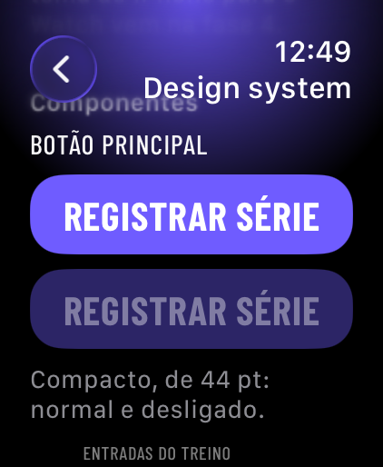

- **No Watch menor:** no Series 11 de 42 mm (187 pt de largura), "Registrar série" quebra em duas linhas, sem cortar, e o botão cresce junto.
- **O contraste medido:** no simulador do Watch (Ultra 3 de 49 mm, watchOS 26.1), o rótulo contra o pixel do botão que menos contrasta com ele, o menor dos quatro temas: 4,52:1 (Ultravioleta, branco sobre #6F5CFF) sem ajuste e 7,05:1 com Aumentar Contraste. A folga de 0,02 fica, pelo que diz [cores.md](cores.md#a-folga-do-botão-principal-no-ultravioleta).

**Teste:** `theWatchButtonIsCompact` (44 pt).

### As entradas do treino

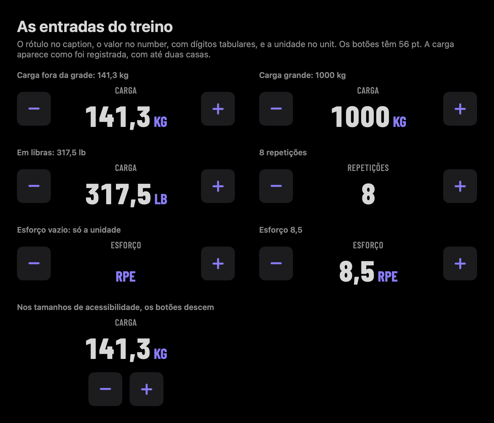

**O que faz:** registra a carga, as repetições e o esforço de uma série, com uma mão, entre séries. Cada entrada tem o rótulo do campo, o valor, a unidade e os botões de diminuir e aumentar.

```swift
LoadInput(value: 141.3, unit: .kg) { direção in /* o motor aplica o passo e devolve o valor novo */ }
RepsInput(value: 8) { direção in }
EffortInput(value: 8.5, scale: .rpe) { direção in }   // value: nil para o esforço vazio
```

- **O valor:** o rótulo vai no `caption`, em cinza (`.secondary`); o valor vai num [número que rola](#o-número-que-rola), no `number`, na cor primária do sistema (branco no escuro); a unidade vai no `unit`, no destaque do tema: KG, LB, RPE ou RIR (o `unit` é em caixa alta). As repetições não têm unidade.
- **Os botões − e +:** 56 pt, raio de 10 pt (`HexRadius.chip`), os símbolos `minus` e `plus` do SF Symbols no destaque do tema, sobre o cartão do sistema (#1C1C1E, ou #242426 com alto contraste), que é um dos fundos onde o texto na cor do tema pode ficar. Cada toque toca o háptico `decrease` ou `increase` e chama o `onStep` com `.down` ou `.up`. Apertados, eles fazem o mesmo que o botão principal.
- **A entrada não decide o passo:** quem usa a entrada aplica o passo pelo motor (as regras do openGym) e passa o valor novo.

**Como a carga aparece:** como foi registrada, nunca arredondada para a grade, com até duas casas, sem zero à direita, sem separar o milhar e no jeito do idioma (`WorkoutFormat.load`). O teste `loadsShowWhatWasLogged` confere:

| Registrada | Em português | Em inglês |
|---|---|---|
| 141,3 | 141,3 | |
| 141,25 | 141,25 | |
| 142,5 | 142,5 | 142.5 |
| 1000 | 1000 | |
| 141,333 | 141,33 | |

**Estados:**

| Estado | Como fica |
|---|---|
| Normal | os botões dos dois lados do valor |
| Tamanhos de acessibilidade (AX1 a AX5) | os botões descem para baixo do valor, lado a lado (`WorkoutInputLayout.axis` dá `.vertical`) |
| Número grande | os dígitos tabulares seguram a largura: 1000 kg e 1111 kg ocupam o mesmo espaço; se não couber, o valor diminui até a metade, sem cortar |
| Esforço vazio | só a unidade aparece, e a entrada tem a mesma altura de quando há um valor: nada pula quando o primeiro valor chega |
| Desligado | os botões ficam com opacidade de 0,4 |

**VoiceOver:**

- O rótulo, o valor e a unidade são um elemento só, ajustável: o VoiceOver diz o rótulo e o valor falado, e deslizar para cima ou para baixo aumenta ou diminui (chama o `onStep`).
- Os botões continuam elementos próprios, "Diminuir" e "Aumentar", para quem usa o Controle por Voz.
- O valor falado diz a unidade por extenso:

| Entrada | Português do Brasil | Inglês |
|---|---|---|
| Carga | "142,5 quilogramas", "317,5 libras", "1 quilograma", "0 quilogramas" (também para 0,001 kg, que a tela mostra como 0) | "317.5 pounds", "1 kilogram", "0 kilograms" |
| Repetições | "1 repetição", "8 repetições", "0 repetições" | "1 repetition", "8 repetitions" |
| Esforço | "RPE 8,5"; vazio, "Esforço não registrado" | "RIR 2"; vazio, "Effort not logged" |

Num aparelho em outro idioma, os textos saem em inglês, com o plural do inglês ("1 repetition" num aparelho em japonês).

**Testes:** `loadsShowWhatWasLogged`, `voiceOverSaysTheUnit`, `anEmptyEffortShowsNothing`, `accessibilitySizesStack`, `bigLoadsKeepTheirWidth`, `anEmptyEffortKeepsItsHeight`, `otherLanguagesUseTheEnglishPlural`, `zeroRepsArePluralInPortuguese`, `zeroLoadsArePluralInPortuguese` e `loadsThatRoundToZeroArePluralInPortuguese` (o 0 é o que o formato de duas casas mostra como 0, e por isso 0,001 kg e -0,001 kg também dizem "0 quilogramas").

**Num cartão:** dentro do cartão do sistema, os botões − e + têm o fundo do próprio cartão, e o contorno deles some; o valor e a unidade continuam legíveis.

**Numa tela que sobe:** a unidade fica no destaque do tema, e num cartão de uma tela que sobe ela iria contra a regra de onde o texto na cor do tema pode ficar ([cores.md](cores.md#onde-o-texto-na-cor-do-tema-pode-ficar)). Por isso, numa tela que sobe, as entradas ficam direto no fundo opaco dela, nunca num cartão dentro dela. Medido no simulador do iPhone, o fundo dessa tela no escuro é #1C1C1E, o mesmo cinza do cartão do sistema, e a unidade no Ultravioleta (#8B7BFF) fica em 5,17:1. É uma escolha recomendada, com a delegação do Lipe de 03/11/2026.

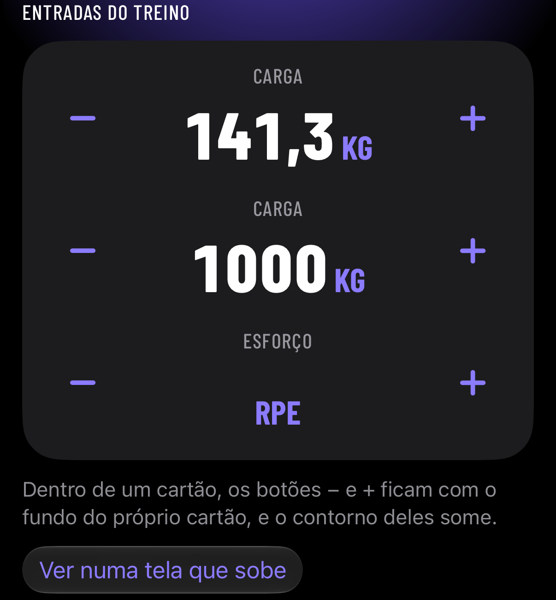

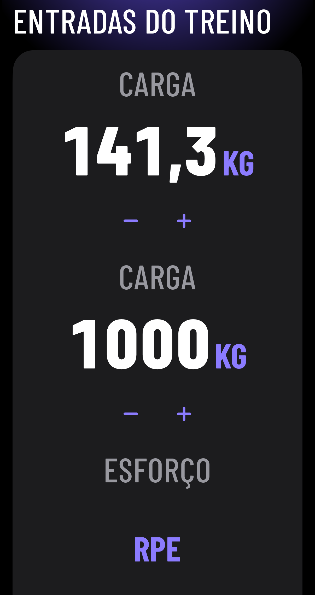

**No Watch:** a variante compacta e a Coroa Digital.

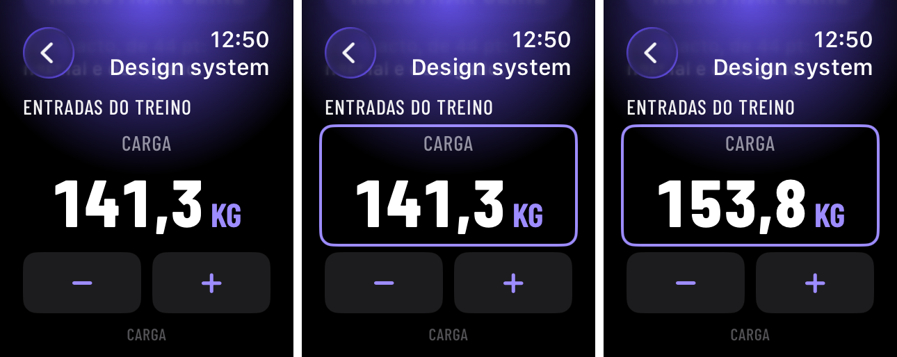

- **A variante compacta:** no Watch, os botões ficam sempre embaixo do valor, lado a lado, em qualquer tamanho de texto (`WorkoutInputLayout.axis` dá `.vertical` no Watch). Cada botão ocupa metade da largura, com altura mínima de 44 pt e o símbolo em 18 pt, e entre o valor e os botões há 8 pt (`HexSpacing.xs`). Os botões embaixo do valor, no Watch, são uma escolha recomendada, com a delegação do Lipe de 03/11/2026.
- **A coroa:** um toque no valor dá a coroa para aquela entrada, e um contorno de 2 pt no destaque do tema, no raio do chip, mostra quem está com ela. Daí, cada degrau da coroa é um passo: chama o `onStep` uma vez, com `.up` ou `.down`, e o motor aplica o passo como num toque nos botões. É o `digitalCrownRotation` da Apple com `by: 1`, sensibilidade `.low`, contínuo e com o háptico da própria coroa a cada degrau (a coroa não toca o `increase` nem o `decrease` por cima). A conta dos degraus é `CrownSteps.steps(from:to:)`: o degrau mais perto do valor novo menos o degrau mais perto do valor velho (o arredondamento, `rounded()`). Um passo por degrau, e o degrau mais perto (#121), são escolhas recomendadas, com a delegação do Lipe de 03/11/2026.
- **Por que só depois do toque:** com várias entradas focáveis ao mesmo tempo na tela, o watchOS passava o foco de uma para outra sem parar (no simulador, centenas de trocas por segundo). Por isso a entrada só pode ter o foco depois de um toque no valor; tocar no valor de outra entrada passa a coroa para ela, e a entrada que perde o foco, ou sai da tela, volta a não ser focável. O foco pelo toque, com o contorno no destaque, é uma escolha recomendada, com a delegação do Lipe de 03/11/2026.
- **O meio do degrau:** com o arredondamento, o passo acontece quando a coroa passa do meio do caminho entre dois degraus, igual para cima e para baixo. Um toque mínimo que sai do degrau e volta não dá passo nenhum. Até a #121 a conta usava o piso (`floor`): o mesmo toque para baixo dava um passo para baixo e outro para cima, e o valor piscava; para cima, não dava nada (achado no QA da PR #86).
- **O + e o − não tiram a coroa:** o foco fica na entrada inteira, com o valor e os dois botões. Com o foco só no valor (até a #121), um toque no + tirava o foco, e girar a coroa depois rolava a tela em vez de mudar o mesmo valor (achado no QA da PR #86). O toque que pega a coroa e o contorno continuam só no valor: um toque no + ou no − de uma entrada sem a coroa não a pega, e a coroa continua rolando a tela. Medido no simulador do Watch (Ultra 3 de 49 mm, watchOS 26.1) com um teste de interface fora do repositório, que toca e gira a coroa pelo `XCUIDevice`: depois do toque no valor, no + e no −, cada giro muda a carga; um toque nas repetições passa a coroa para elas.

**O contraste medido:** no simulador do Watch, pelo pior pixel, o menor dos quatro temas:

| Parte | Sem ajuste | Com Aumentar Contraste |
|---|---|---|
| A unidade (KG), no destaque sobre o preto | 7,63:1 | 9,53:1 |
| O rótulo (CARGA), cinza sobre o preto | 5,50:1 | 8,12:1 |
| O + e o −, no destaque sobre o cartão do sistema (#1C1C1E, ou #242426) | 6,18:1 | 7,03:1 |
| O contorno do foco, no destaque sobre o preto | 7,48:1 | 9,45:1 |

**Testes:** `eachCrownDetentIsOneStep` (cada degrau é um passo, para cima e para baixo, e meio degrau não é nenhum) e `aNudgeThatComesBackIsNoStep` (um toque mínimo que sai do degrau e volta não dá passo, nos dois sentidos, e um degrau inteiro dá um passo só).

### Os segmentos inclinados

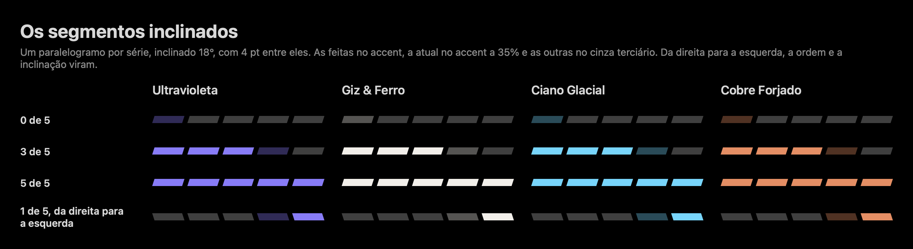

**O que faz:** mostra as séries do exercício numa linha, um paralelogramo por série.

```swift
SlantedSegments(total: 5, done: 3)
```

- **Forma:** cada segmento é inclinado 18°, com o alto puxando para a direita, e há 4 pt (`HexSpacing.xxs`) entre eles. A linha ocupa a largura toda. A altura é de 10 pt e cresce com o Dynamic Type. A inclinação de 18° é uma escolha recomendada, com a delegação do Lipe de 03/11/2026.

**Estados:**

| Segmento | Cor |
|---|---|
| Série feita | destaque do tema |
| Série atual (a seguinte às feitas) | destaque do tema a 35% |
| Séries que faltam | cinza terciário do sistema |

- **Da direita para a esquerda** (árabe, hebraico), a linha começa na direita, e a inclinação vira junto. O teste `segmentsLightFromTheStartOfTheLine` confere que, com uma série feita, o lado de onde a linha começa é o mais claro.

**VoiceOver:** a linha é um elemento só, com o rótulo "Séries" e o valor "3 de 5 séries" ("3 of 5 sets" em inglês). O plural segue o total: "0 de 1 série", "0 de 0 séries", "1 of 1 set".

**Testes:** `segmentsLightFromTheStartOfTheLine`, `segmentsSayWhereYouAre`, `otherLanguagesCountSetsInEnglish` e `zeroSetsArePluralInPortuguese`.

**No simulador:** os segmentos, o carimbo e o anel na galeria do iPhone, no tamanho de texto padrão e em AX5. Em AX5, a linha de segmentos e o anel cabem na largura da tela, sem cortar.

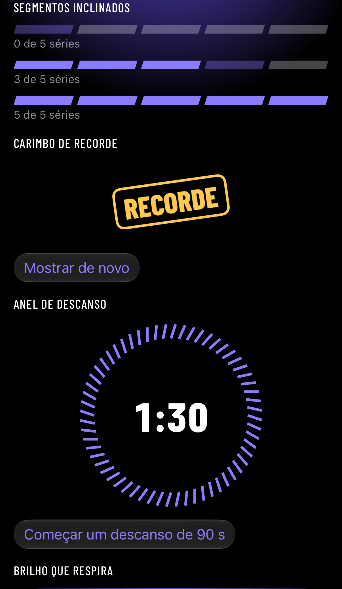

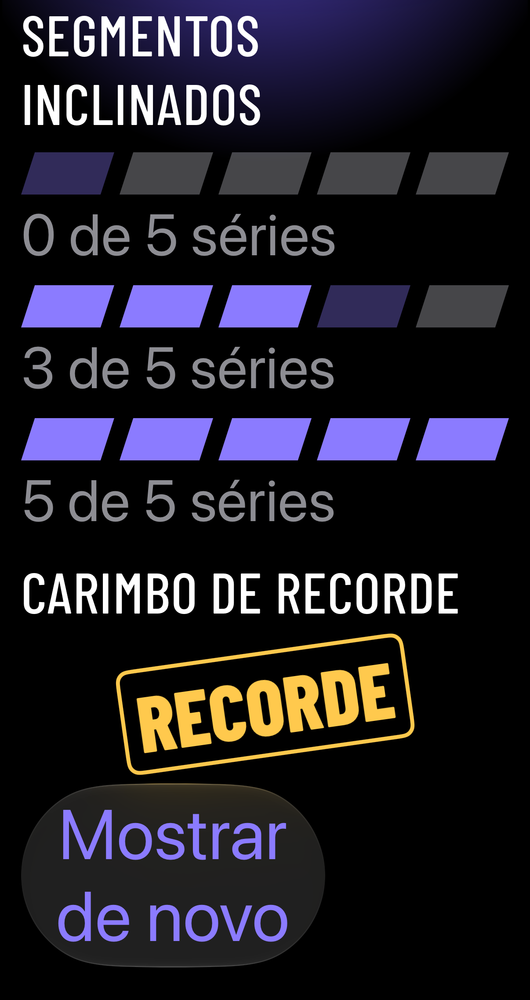

**No Watch:** iguais aos do iPhone, na largura da tela: 0, 3 e 5 de 5 na galeria do Watch, com o valor falado embaixo.

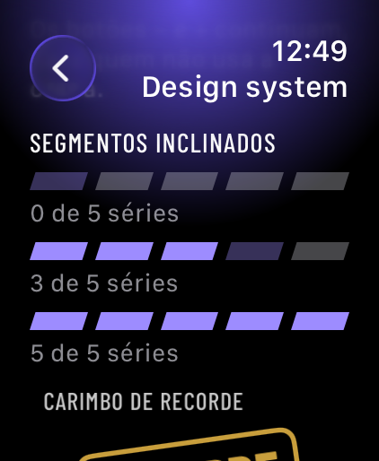

### O carimbo de recorde

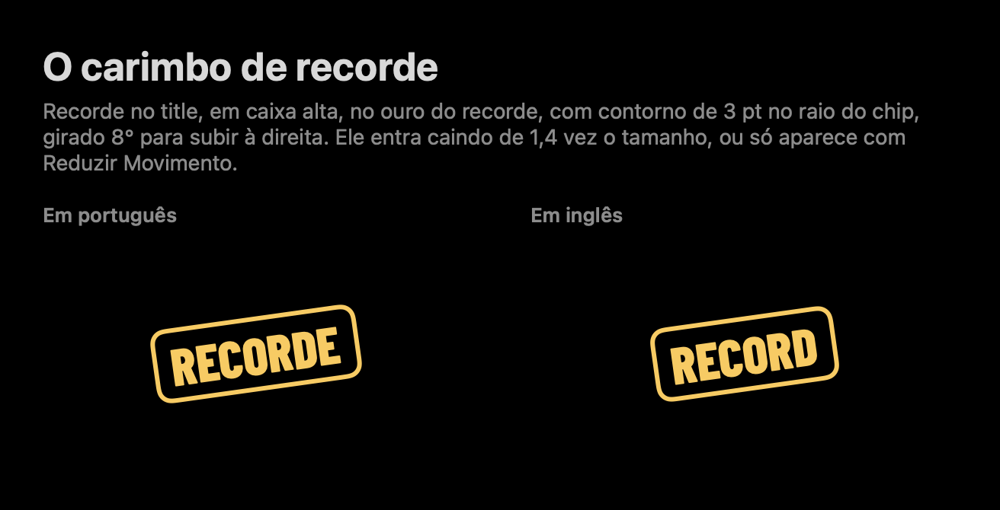

**O que faz:** marca um recorde novo. "Recorde" ("Record" em inglês) no `title`, em caixa alta, no ouro do recorde, com contorno de 3 pt no raio de 10 pt (`HexRadius.chip`).

```swift
RecordStamp(isShown: bateuRecorde)
```

- **A inclinação:** o carimbo gira -8° no `rotationEffect` (`.rotationEffect(.degrees(-8))`), e por isso sobe para a direita, como os segmentos. No print, o texto da folha diz "girado 8° para subir à direita": é o mesmo giro, escrito pelo sentido.
- **O ouro:** a cor do recorde da paleta, #FFC94D no escuro. O recorde é sempre em ouro, em todo tema.
- O carimbo dourado em contorno, o giro e a queda de 1,4 vez o tamanho são escolhas recomendadas, com a delegação do Lipe de 03/11/2026.

**Estados:**

| Momento | O que acontece |
|---|---|
| `isShown` passa de falso para verdadeiro | o carimbo cai de 1,4 vez o tamanho até o tamanho dele, e de transparente a visível, com o movimento `celebrate`; toca o háptico `record`; e o VoiceOver anuncia "Novo recorde" |
| A mesma passagem, com Reduzir Movimento | ele só aparece, por opacidade, sem mudar de tamanho; o háptico e o anúncio continuam |
| O carimbo já abre com `isShown` verdadeiro | aparece parado, sem animação, sem háptico e sem anúncio |
| `isShown` volta para falso | some na hora, sem animação, pronto para o próximo recorde |

O carimbo só anima, toca e anuncia na passagem de `isShown` de falso para verdadeiro. Para mostrar um recorde que acabou de acontecer, a tela troca o `isShown` de um carimbo que já está montado. A galeria faz assim: o carimbo fica montado, cai quando a parte dele aparece na tela, e o botão "Mostrar de novo" põe o `isShown` em falso e, 0,3 s depois, em verdadeiro.

- **Com Dynamic Type:** o texto cresce com o `title` até o teto de 60 pt, numa linha só.
- **Com o Texto em Negrito:** fica igual, porque o `title` já está no peso 800, o mais forte do pacote.

**VoiceOver:** escondido enquanto não aparece. Mostrado, é um elemento só, "Recorde". Na chegada, o anúncio "Novo recorde".

**Testes:** `theStampLandsOrFades` (cai de 1,4 sem Reduzir Movimento, e de 1 com ele).

**No Watch:** o mesmo carimbo, com a mesma queda, numa linha só na largura do Watch. Na galeria do Watch, o botão "Mostrar de novo" faz o mesmo que no iPhone. O ouro sobre o preto mediu 9,45:1 sem ajuste e 12,30:1 com Aumentar Contraste, pelo pior pixel.

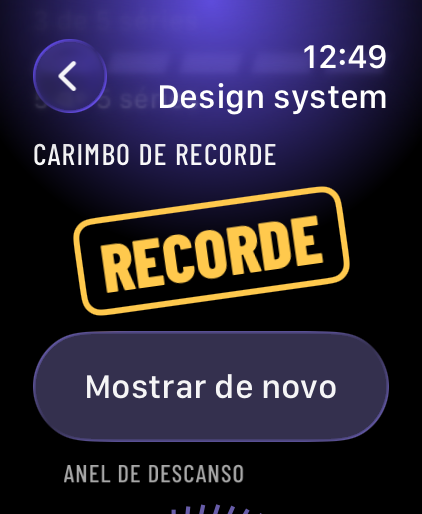

### O anel de descanso

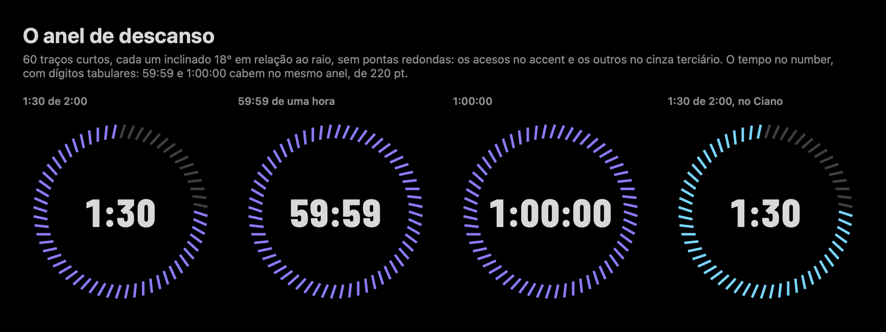

**O que faz:** mostra o tempo de descanso que falta, com o tempo no centro.

```swift
RestRing(total: 120, remaining: 90)   // em segundos
```

- **Forma:** 60 traços curtos em volta de um círculo, cada um inclinado 18° em relação ao raio, retos, sem pontas redondas. Os acesos ficam no destaque do tema, e os apagados no cinza terciário do sistema. Assim ele não parece um anel de atividade da Apple, que é uma faixa contínua com pontas redondas. O anel em 60 traços inclinados é uma escolha recomendada, com a delegação do Lipe de 03/11/2026.
- **A direção:** os traços contam a partir do alto, no sentido do relógio. O tempo que passa apaga os traços nessa mesma direção, como um ponteiro: com 1:30 de 2:00, os 15 traços apagados vão do alto até as três horas.
- **Não espelha:** da direita para a esquerda, o anel continua igual, no sentido do relógio, porque ele é um relógio.
- **Quantos acendem:** `RestRingModel.litTicks` dá o arredondamento de 60 × o que falta ÷ o total, entre 0 e 60, e 0 quando o total é 0.
- **O tempo:** no centro, num [número que rola](#o-número-que-rola) no `number`. Abaixo de uma hora, `m:ss` (1:30, 59:59); a partir dela, `h:mm:ss` (1:00:00, 1:02:05); um valor negativo dá 0:00. Se o tempo não couber, ele diminui até a metade, sem cortar.
- **O tamanho:** 220 pt de diâmetro no tamanho de texto padrão, crescendo com o Dynamic Type, e nunca maior que a largura que tem: numa largura de 150 pt, o anel fica com 150 pt. O tamanho do anel não depende do texto, e 59:59 virando 1:00:00 não muda nada de tamanho.

**Estados:**

| Momento | O que acontece |
|---|---|
| Contando | os traços acesos diminuem e o tempo rola |
| O tempo chega a zero | toca o háptico `restDone` (`.warning` no iPhone) |

**VoiceOver:** um elemento só, com o rótulo "Descanso", o valor falado ("1 minuto e 30 segundos", "1 hora"; em inglês, "1 minute, 30 seconds") e o traço de que atualiza com frequência.

**O zero em português:** o CLDR do português põe o 0 na forma `one`, e o formato da Apple diria "0 segundo" justo quando o descanso acaba. Por isso o 0 em português vem da tabela `Progress` (`rest.zero`), no plural: "0 segundos". Um valor negativo também é o 0. Em inglês, o formato da Apple já diz "0 seconds".

**Testes:** `restTimeNeverJumps`, `restTimeIsSpoken`, `theRingCountsDownInTicks`, `theRingKeepsItsSizeWhenAnHourBegins`, `theRingNeverOutgrowsItsWidth` e `zeroRestIsPluralInPortuguese`.

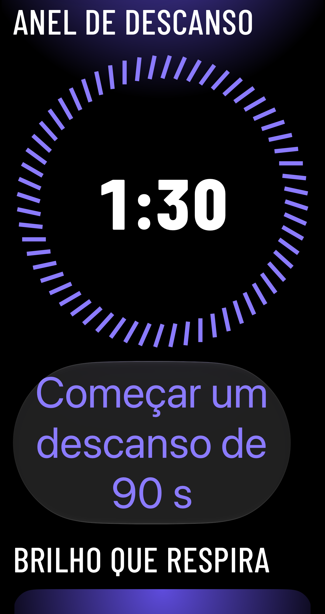

**No Watch:** o mesmo anel de 60 traços inclinados, retos, que no Watch é onde ele mais precisa não parecer um anel de atividade: nada de faixa contínua nem de pontas redondas. No tamanho de texto padrão do Watch, o diâmetro é o que o `ScaledMetric` dá no modelo (no watchOS 26.1, 198 pt no Ultra 3 de 49 mm e 220 pt no SE 3 de 40 mm), e ele nunca passa da largura da tela. O teste `theRingNeverOutgrowsItsWidth` compara o anel com o mesmo `ScaledMetric` medido no aparelho, e espera 220 pt exatos no iPhone e no Mac (#121). Quando o tempo chega a zero, o háptico `restDone` é o `.start` do Watch.

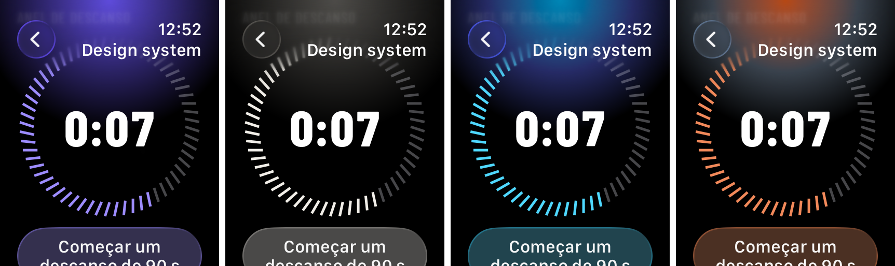

### O brilho que respira

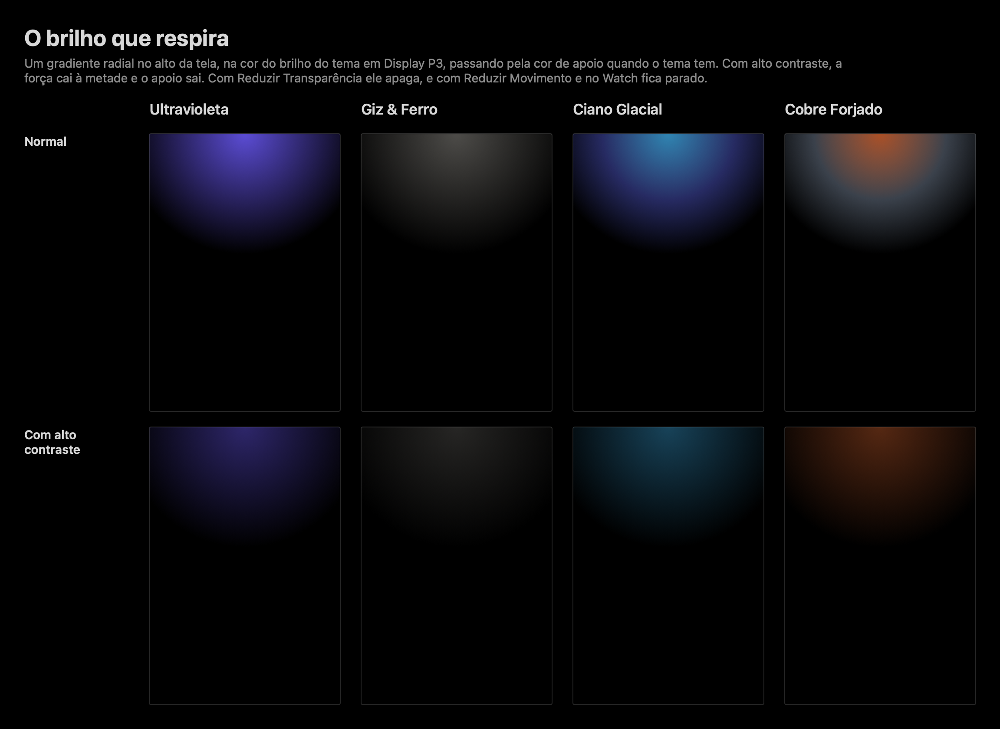

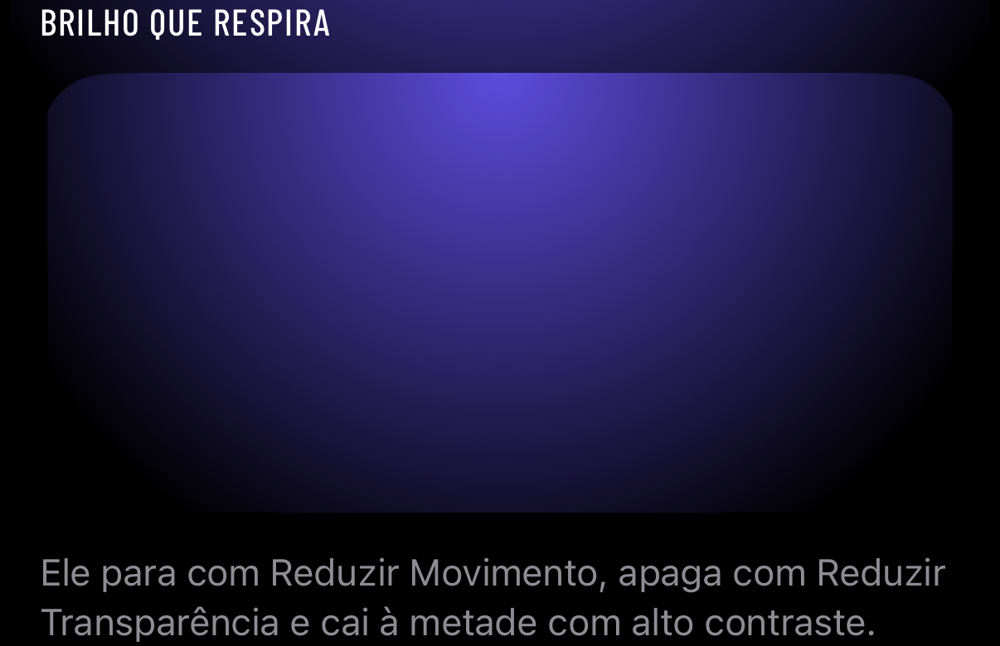

**O que faz:** o fundo das telas do app: preto, com um brilho na cor do tema no alto, que cresce e encolhe devagar.

```swift
TelaQualquer().background { BreathingGlow() }
```

- **Forma:** um gradiente radial que sai do meio do alto da tela e vai até 60% da largura. Começa na cor do brilho do tema, em Display P3, com a opacidade do tema, e some até zero. Quando o tema tem cor de apoio (Ciano e Cobre), o gradiente passa por ela no ponto 0,55 do raio, com metade da opacidade do brilho, e dali some até zero.
- **A respiração:** a escala vai e volta entre 95% e 105%, a partir do alto, num ciclo de 4 s, com o movimento `breathe`.
- **Fica atrás de tudo:** cobre a tela toda, inclusive as áreas seguras, não recebe toque e não aparece para o VoiceOver.
- O brilho com metade da força no alto contraste, apagado com Reduzir Transparência e parado no Watch são escolhas recomendadas, com a delegação do Lipe de 03/11/2026.

**Estados** (`GlowSpec.resolve`):

| Situação | Como fica |
|---|---|
| Normal | respira, na opacidade do tema (0,85 no Ultravioleta) |
| Alto contraste | a opacidade cai à metade (0,425 no Ultravioleta) e a cor de apoio sai |
| Reduzir Movimento | fica parado, no tamanho 1 |
| Reduzir Transparência | apaga: fica só o preto |
| Claro | não há brilho: fica só o preto |
| Watch | fica parado |

**VoiceOver:** nenhum. O brilho é decoração.

**Testes:** `theGlowFollowsAccessibility`, `noGlowOnLightAndAStillGlowOnTheWatch`, `theGlowStopsStillWhenReduceMotionTurnsOn` e `theGlowCarriesTheSupportColorUnlessContrastIsUp`.

**No simulador:** com a galeria aberta no brilho, ligar o Reduzir Movimento no meio do ciclo deixa o brilho parado: dois prints com 1,5 s entre eles são iguais pixel a pixel, e iguais (com diferença de no máximo 2 em 255, do pontilhado) ao brilho de quando o app já abre com Reduzir Movimento, no tamanho 1. Desligado de novo, ele volta a respirar. Com Reduzir Transparência, o brilho apaga.

**No Watch:** o brilho usa a superfície do Watch e fica parado, no tamanho 1. É o fundo do app inteiro do Watch, atrás da tela de início e da galeria. A superfície vem de `HexPlatform.current.surface`, a mesma fonte dos hápticos, das cores (`hexPalette`) e do brilho: o Watch de um é o Watch dos outros (QA da PR #74).

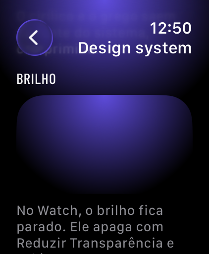

## Da Apple, com a marca

São componentes da Apple, com o comportamento dela. O HexGym só põe a cor, a tipografia e a composição.

### O número que rola

**O que faz:** um número que rola os dígitos quando muda, para cima quando cresce e para baixo quando diminui. É a transição `numericText` da Apple, com a nossa tipografia.

```swift
RollingNumber(value: 142.5, text: "142,5")                    // no number
RollingNumber(value: 90, text: "1:30", style: .display)
```

- `value` dá o sentido da rolagem; `text` é o que aparece, já formatado.
- O estilo padrão é o `number`. Nos estilos de números, os dígitos tabulares fazem o número mudar sem pular de largura.
- A troca usa o movimento `change`.

**Estados:**

| Situação | Como muda |
|---|---|
| Normal | os dígitos rolam (`.numericText(value:)`) |
| Reduzir Movimento | o número troca por opacidade (`.opacity`) |

**VoiceOver:** lê o texto como ele aparece. Nas entradas do treino e no anel, quem fala é o elemento de fora, com a unidade.

**Testes:** `rollingNumbersRollUnlessReduceMotion`.

**No Watch:** igual. Os dígitos rolam a cada degrau da coroa nas entradas, a cada segundo no anel e no "Mais um" do cartão de vidro da galeria do Watch; o vídeo da [prints/65](../prints/65/video.mp4) mostra a carga rolando pela coroa.

**Print:** o número que rola aparece nos prints das [entradas do treino](#as-entradas-do-treino) e do [anel de descanso](#o-anel-de-descanso). A rolagem em si se vê na galeria do iPhone, no botão "Mais um" do cartão de vidro e nas entradas.

### O cartão de vidro

**O que faz:** um cartão de informação no vidro da Apple (Liquid Glass), tingido pelo tema.

```swift
HexGlassCard {
  Text("Semana 3").foregroundStyle(Color.white)
  Text(verbatim: "4 treinos").hexFont(.title).foregroundStyle(Color.white)
}
```

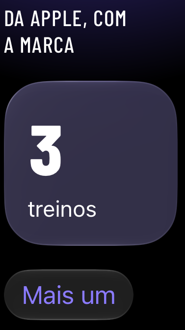

- **Forma:** o conteúdo com 16 pt de margem (`HexSpacing.m`), no vidro regular da Apple, com raio de 28 pt (`HexRadius.card`), contínuo.
- **A tinta:** o destaque do tema a 18%. O vidro tingido com o destaque a 18% e sem tinta no alto contraste é uma escolha recomendada, com a delegação do Lipe de 03/11/2026.
- **O texto sobre o vidro:** só branco, nunca na cor do tema nem no cinza secundário. É a regra da #71 ([cores.md](cores.md#onde-o-texto-na-cor-do-tema-pode-ficar)): o texto na cor do tema só fica sobre o fundo da tela e sobre o cartão do sistema. O cinza secundário do sistema (`.secondary`) mediu de 3,1 a 3,2:1 sobre o vidro, abaixo de 4,5, e por isso saiu. Só branco sobre o vidro é uma escolha recomendada, com a delegação do Lipe de 03/11/2026.

**O contraste medido:** no simulador do iPhone (iOS 27.0), em prints da galeria. O vidro muda com o que está atrás, e o brilho do topo é o fundo mais claro que ele pega na galeria. A conta que vale é a menor: o branco contra o pixel do vidro que menos contrasta com ele, em qualquer ponto do cartão (fora do próprio texto e da borda serrilhada dele). Ao lado, a cor mais comum do vidro, para comparar.

| Situação | Menor contraste (pior pixel do vidro) | Na cor mais comum |
|---|---|---|
| Ultravioleta | 11,04:1 (#3C3953) | 12,67:1 (#333048) |
| Giz & Ferro | 8,54:1 (#4E4C4B) | 9,60:1 (#454544) |
| Ciano Glacial | 9,42:1 (#304A53) | 10,83:1 (#284148) |
| Cobre Forjado | 10,53:1 (#4E3B31) | 12,00:1 (#46322A) |
| Prévia de alto contraste (sem tinta) | 14,28:1 (#2C2A29, no Cobre) | 16,29:1 (#202020) |
| Aumentar Contraste (sem tinta) | 15,60:1 (#222424, no Ciano) | 16,86:1 (#1D1D1D) |
| Reduzir Transparência (Ultravioleta) | 14,53:1 (#292640) | 14,74:1 (#28253E) |

**Estados:**

| Situação | Como fica |
|---|---|
| Normal | vidro regular, tingido pelo destaque a 18% (`HexGlass.tintOpacity` dá 0,18) |
| Aumentar Contraste, ou a prévia de alto contraste | vidro regular sem tinta (`tintOpacity` dá nil) |
| Reduzir Transparência | o sistema deixa o vidro opaco: no simulador, ele vira uma cor lisa, #28253E no Ultravioleta, sem o desfoque nem a variação de cor de cima para baixo (sem o ajuste, ela vai de #3A3750 a #423E58). Como o brilho também apaga, o que está atrás é preto, e o print não separa um vidro opaco de um transparente sobre o preto; a cor lisa é o que dá para ver |

**VoiceOver:** o vidro não é um elemento; o VoiceOver lê o conteúdo.

**Testes:** `theGlassTakesTheThemeUnlessContrastIsUp`.

**No Watch:** o mesmo cartão, com a mesma tinta e o texto só em branco. O branco sobre o vidro mediu 6,70:1 sem ajuste e 15,36:1 com Aumentar Contraste, pelo pior pixel, o menor dos quatro temas.

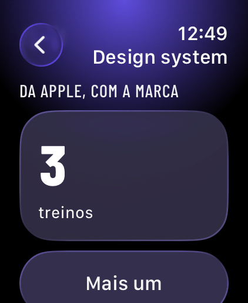

### Os botões secundários

**O que faz:** os botões que não são a ação principal da tela, no estilo `.glass` da Apple, tingidos pelo destaque do tema.

```swift
HStack {
  Button("Pular") {}
  Button("Trocar exercício") {}
}
.hexSecondaryButton()   // os botões dentro desta view
```

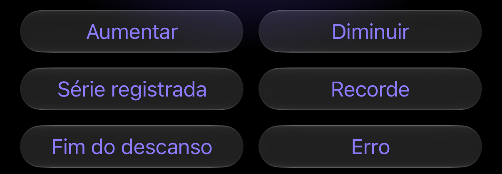

**Estados:** os da Apple (apertado, desligado), com a tinta no destaque do tema. Com Aumentar Contraste, continuam tingidos, com o destaque de alto contraste; só o cartão de vidro perde a tinta.

**O contraste medido:** no iPhone, o rótulo do `.glass` tingido sai na cor do destaque, sobre um vidro escuro, e não em branco como no macOS (onde o branco deu 2,14:1 no Cobre). No simulador do iPhone (iOS 27.0), em prints da galeria, o menor valor: o rótulo contra o pixel do botão que menos contrasta com ele (o vidro clareia perto da borda de cima, até #262626, ou #222222 com Aumentar Contraste). Entre parênteses, o valor na cor mais comum do botão (#202020, ou #1B1B1B com Aumentar Contraste).

| Tema | Sem ajuste | Com Aumentar Contraste |
|---|---|---|
| Ultravioleta | 4,59:1 (4,95:1) | 7,24:1 (7,84:1), rótulo #ABA5FF |
| Giz & Ferro | 13,19:1 (14,20:1) | 13,86:1 (15,01:1) |
| Ciano Glacial | 9,08:1 (9,78:1) | 9,55:1 (10,33:1) |
| Cobre Forjado | 6,13:1 (6,60:1); 6,86:1 (7,39:1) com a prévia de alto contraste | 7,22:1 (7,81:1), rótulo #F5976C |

Os quatro passam de 4,5:1, com e sem Aumentar Contraste, e por isso o rótulo fica como a Apple desenha. O Ultravioleta sem ajuste é o mais justo: 4,59:1 no pixel mais claro. Com Reduzir Transparência, o botão vira uma cor lisa, #141414, e o rótulo no Ultravioleta fica em 5,23:1 no pior pixel (5,59:1 na cor mais comum).

**VoiceOver:** são botões do SwiftUI; o VoiceOver lê o rótulo como botão.

**No Watch:** o `.glass` tingido do Watch desenha o rótulo em branco, e não na cor do destaque como no iPhone (é o desenho da Apple; o pacote não muda). O branco sobre o vidro tingido mediu 8,31:1 sem ajuste e 8,18:1 com Aumentar Contraste, pelo pior pixel, o menor dos quatro temas. No print do [cartão de vidro](#o-cartão-de-vidro) do Watch, o "Mais um" é um botão secundário; no do [anel](#o-anel-de-descanso), o "Começar um descanso de 90 s" também.

### A transição de "Começar treino"

**O que faz:** a assinatura do HexGym: o botão "Começar treino" cresce até virar a tela do treino. É o zoom de navegação da Apple.

```swift
@Namespace private var zoom
@Environment(\.accessibilityReduceMotion) private var reduceMotion
@State private var caminho = NavigationPath()

NavigationStack(path: $caminho) {
  Button("Começar treino") {
    withTransaction(StartWorkoutTransition.transaction(reduceMotion: reduceMotion)) { caminho.append(Treino()) }
  }
  .buttonStyle(.hexPrimary)
  .hexStartWorkoutSource(id: "treino", in: zoom)
  .navigationDestination(for: Treino.self) { _ in
    TelaDoTreino().hexStartWorkoutDestination(id: "treino", in: zoom)
  }
}
```

- A origem (`hexStartWorkoutSource`) marca o botão de onde o zoom sai, e o destino (`hexStartWorkoutDestination`) põe o zoom na tela do treino.
- Quem abre a tela do treino o faz dentro de `withTransaction(StartWorkoutTransition.transaction(reduceMotion:))`.
- **Pelo caminho da pilha:** a tela entra com `append` no caminho do `NavigationStack(path:)`. Medido no simulador do iOS 27.0: com `navigationDestination(isPresented:)`, a transação sem animação não chega ao empurrão da pilha, e com Reduzir Movimento a tela entra deslizando da direita; pelo caminho, ela aparece de uma vez.

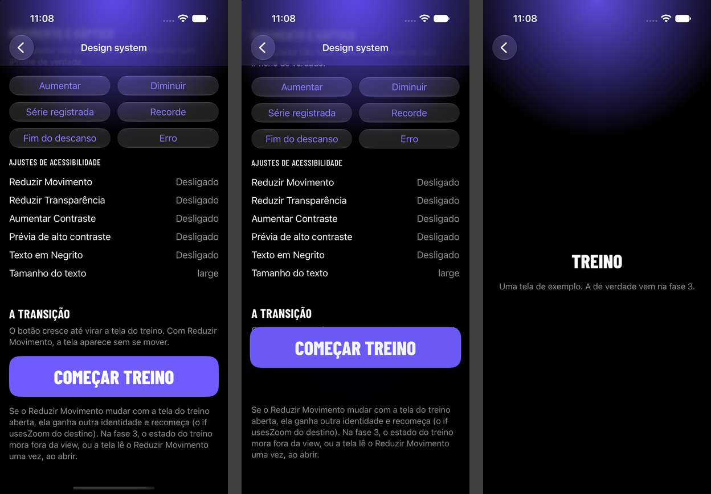

**Estados:**

| Situação | Como abre |
|---|---|
| Normal | com o zoom (`usesZoom` dá verdadeiro) |
| Reduzir Movimento | sem zoom, e a transação desliga as animações: a tela aparece sem se mover. Essa troca é uma escolha recomendada, com a delegação do Lipe de 03/11/2026 |

**No simulador, com Reduzir Movimento:** prints a cada 0,1 s depois do toque mostram a galeria e, no seguinte, a tela do treino inteira, no lugar; os prints depois dele são iguais pixel a pixel. Sem o ajuste, o print do meio pega o zoom.

**Para saber:** se o Reduzir Movimento mudar com a tela do treino aberta, a tela do treino ganha outra identidade e recomeça o estado dela (o `if usesZoom` do destino). Hoje isso não afeta ninguém, porque a tela do treino de verdade é da fase 3: nela, o estado do treino mora fora da view, ou a tela lê o Reduzir Movimento uma vez, ao abrir. A galeria diz isso numa nota.

**VoiceOver:** a navegação é a da Apple; o VoiceOver anuncia a tela nova como em qualquer navegação.

**Testes:** `theZoomStepsAsideForReduceMotion` e `theWorkoutScreenAppearsStillWithReduceMotion`.

**No Watch:** não há o zoom. No Watch, a navegação é a da Apple, empurrando a tela da direita, como da tela de início para a galeria; a tela do treino do Watch é da fase 3, e a galeria do Watch não mostra a transição.

**Print:** o print está no começo desta parte; o vídeo da galeria, com a troca de tema e o zoom, está em [prints/64](../prints/64/video.mp4). Até a fase 3, ela aparece na galeria.
