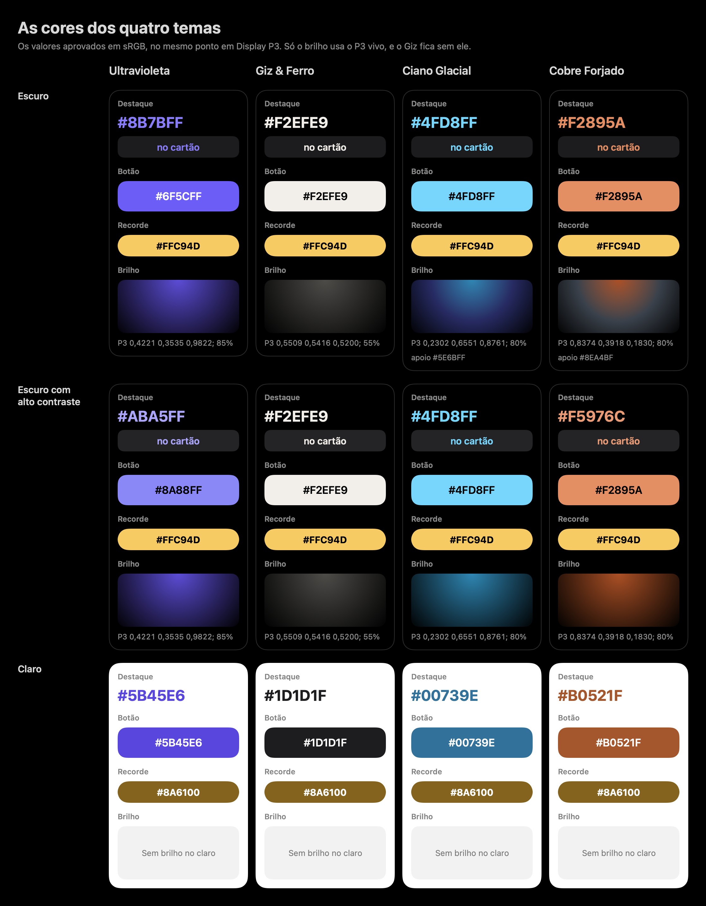

# As cores

Quatro temas, escolhidos pelo usuário: Ultravioleta (o padrão), Giz & Ferro, Ciano Glacial e Cobre Forjado. Cada um tem as cores do escuro, do escuro com alto contraste e do claro, e o Ultravioleta tem um tom próprio para o Watch e para a ilha (a Dynamic Island e a Live Activity). O estudo que levou a essas cores está em [estudo-de-cor-2026-10-31.md](../../brand/estudo-de-cor-2026-10-31.md).

No código: `HexPalette.resolve(_:scheme:contrast:surface:)`, em `Color/HexPalette.swift`, e o `HexRGB`, em `Color/HexRGB.swift`. Os testes estão em `ColorTests.swift`.

## Como as cores chegam à tela

- **O valor aprovado é sRGB.** Cada cor é um `HexRGB` (0xRRGGBB), e as contas de contraste usam esse valor.
- **Na tela, tudo vai em Display P3, no mesmo ponto.** O `Color(_:)` do pacote tira a curva do sRGB, passa do sRGB linear para o Display P3 linear e põe a curva de volta. Assim a cor aparece igual à aprovada. Por exemplo, o #8B7BFF vira 0,5346 0,4846 0,9682 em Display P3, e o #FFC94D vira 0,9668 0,7965 0,3914 (o teste `displayP3KeepsTheApprovedColor` confere até a quarta casa).
- **O P3 mais vivo fica só no brilho.** O `glow` de cada tema já vem em Display P3 (`HexP3`), com a opacidade. O Giz fica sem P3 vivo: o brilho dele é o cinza #8D8A84 convertido para o mesmo ponto.

## A tabela dos quatro temas

O `accent` é o destaque (texto, ícones e traços na cor do tema). O `fill` é o fundo do botão principal, e o `onFill` é o rótulo dele.

| Tema | `accent` | `fill` / `onFill` | Alto contraste: `accent` | Alto contraste: `fill` / `onFill` | Claro | Claro com alto contraste | Watch e ilha | Apoio | Brilho (Display P3; opacidade) |
|---|---|---|---|---|---|---|---|---|---|
| Ultravioleta | #8B7BFF | #6F5CFF / branco | #ABA5FF | #8A88FF / preto | #5B45E6 | #5339DB | #9D8CFF | nenhum | 0,4221 0,3535 0,9822; 0,85 |
| Giz & Ferro | #F2EFE9 | #F2EFE9 / preto | #F2EFE9 | #F2EFE9 / preto | #1D1D1F | #1D1D1F | o do app | nenhum | #8D8A84 no mesmo ponto (0,5509 0,5416 0,5200); 0,55 |
| Ciano Glacial | #4FD8FF | #4FD8FF / preto | #4FD8FF | #4FD8FF / preto | #00739E | #005F84 | o do app | #5E6BFF | 0,2302 0,6551 0,8761; 0,8 |
| Cobre Forjado | #F2895A | #F2895A / preto | #F5976C | #F2895A / preto | #B0521F | #973D00 | o do app | #8EA4BF | 0,8374 0,3918 0,1830; 0,8 |

Como ler a tabela:

- **No claro**, o `accent` e o `fill` são o mesmo valor da coluna "Claro" (ou da coluna com alto contraste), e o `onFill` é sempre branco. O primeiro TestFlight é só escuro: os valores claros valem onde o iOS força claro (widgets, tela bloqueada) e ficam prontos para um modo claro depois.
- **O recorde** é #FFC94D com texto preto no escuro, com ou sem alto contraste. No claro é #8A6100, e #765200 com alto contraste, os dois com texto branco.
- **O Watch e a ilha** só mudam o `accent` do Ultravioleta no escuro sem alto contraste: #9D8CFF. Com alto contraste, valem o #ABA5FF do app; nos outros temas, o `accent` do app.
- **O apoio** é a segunda cor do gradiente do brilho. Ele sai com alto contraste. No claro sem alto contraste o `support` continua preenchido, mas o claro não tem brilho (`glow` nil), então ele não aparece.
- **O brilho** não existe no claro. Com alto contraste a paleta guarda a mesma opacidade, e quem corta pela metade é o brilho que respira (veja [componentes.md](componentes.md#o-brilho-que-respira)).

## Os fundos

| Fundo | Valor | Onde |
|---|---|---|
| Fundo da tela | #000000 | o preto do app escuro |
| `HexRGB.card` | #1C1C1E | o cartão do sistema no escuro (o `secondarySystemBackground`) |
| `HexRGB.cardIncreased` | #242426 | o mesmo cartão com Aumentar Contraste (o `systemGray6` acessível do HIG da Apple) |

## Onde o texto na cor do tema pode ficar

Esta é a regra de uso da #71, com ou sem alto contraste:

- O texto na cor do tema (`accent`) fica **só sobre o fundo da tela e sobre o cartão do sistema**: #1C1C1E, ou #242426 com Aumentar Contraste.
- Os cartões dentro de uma tela que sobe de baixo (o cinza elevado do sistema) levam **texto branco ou nos cinzas do sistema**, nunca na cor do tema.
- O mesmo vale para o cartão de vidro: o texto sobre ele vai em branco ou nos cinzas do sistema (veja [componentes.md](componentes.md#o-cartão-de-vidro)).

Os testes medem o `accent` só nesses fundos. Fora deles, o contraste não é garantido: no cinza elevado #2C2C2E, por exemplo, o #8B7BFF fica abaixo de 4,5.

## As regras de contraste

O contraste é o da WCAG 2.2: a luminância relativa é 0,2126 R + 0,7152 G + 0,0722 B, nos componentes lineares (a curva do sRGB com o limiar 0,04045), e a razão é (L1 + 0,05) / (L2 + 0,05), com L1 a maior das duas. Vai de 1 a 21 e é a mesma nos dois sentidos.

O teste `everyPairMeetsItsRule` confere cada regra nos quatro temas, sem e com alto contraste. Os "fundos do escuro" são o preto e o `card`; com alto contraste, também o `cardIncreased`.

| Par | Sem alto contraste | Com alto contraste |
|---|---|---|
| `accent` em cada fundo do escuro | 4,5 | 7 |
| `onFill` sobre o `fill`, no escuro | 4,5 | 7 |
| `fill` contra cada fundo do escuro (o contorno do botão) | 3 | 3 |
| recorde contra cada fundo do escuro, e `onRecord` sobre o recorde | 4,5 | 7 |
| no claro: `accent` no branco, e branco sobre o `fill` | 4,5 | 7 |
| no claro: `fill` contra o branco | 3 | 3 |
| no claro: recorde no branco, e o texto branco sobre o recorde | 4,5 | 7 |
| `accent` do Watch e da ilha no preto | 4,5 | 7 |

Os números que os testes conferem um a um (`contrastFollowsWCAG`):

- branco no preto: 21;
- #8B7BFF no preto: 6,37;
- branco no #6F5CFF: 4,52, o mesmo nos dois sentidos.

Os pares com pouca folga, para quem pensar em mudar uma cor. O critério: todos os pares que o `everyPairMeetsItsRule` confere e que ficam menos de 0,1 acima da regra deles, do menor para o maior. Nenhum par da regra 3 fica tão perto. As contas usam a mesma fórmula do pacote.

| Par | Tema e modo | Contraste | Regra |
|---|---|---|---|
| branco no #6F5CFF | Ultravioleta, escuro: o rótulo do botão | 4,52 | 4,5 |
| #F5976C no #242426 | Cobre, escuro com alto contraste: o destaque no cartão | 7,03 | 7 |
| #973D00 no branco, e o branco no #973D00 | Cobre, claro com alto contraste: o destaque e o rótulo do botão | 7,04 | 7 |
| preto no #8A88FF | Ultravioleta, escuro com alto contraste: o rótulo do botão | 7,05 | 7 |
| #ABA5FF no #242426 | Ultravioleta, escuro com alto contraste: o destaque no cartão | 7,05 | 7 |
| #765200 no branco, e o branco no #765200 | todos os temas, claro com alto contraste: o recorde e o texto dele | 7,05 | 7 |
| #5339DB no branco, e o branco no #5339DB | Ultravioleta, claro com alto contraste: o destaque e o rótulo do botão | 7,06 | 7 |
| #005F84 no branco, e o branco no #005F84 | Ciano, claro com alto contraste: o destaque e o rótulo do botão | 7,07 | 7 |

Quem mudar uma cor e passar da regra vê o teste cair.

## Como saíram os tons de alto contraste da #71

Com Aumentar Contraste, o cartão do sistema fica #242426, e os primeiros tons de alto contraste do Ultravioleta (#A29BFF) e do Cobre (#F48B5C) davam 6,40 e 6,41 ali, abaixo de 7. Os tons novos saíram assim:

1. A cor de partida é misturada com o branco no sRGB, canal a canal, com arredondamento: cada canal vira `c + p * (255 - c)`, arredondado.
2. A mistura anda em passos de 1%.
3. Vale o primeiro passo que chega a 7 no #242426.

| Partida | 9% (ainda não) | 10% (o escolhido) |
|---|---|---|
| #A29BFF | #AAA4FF, 6,98 | **#ABA5FF**, 7,05 |
| #F48B5C | #F5956B, 6,93 | **#F5976C**, 7,03 |

O teste `increasedContrastTextClearsTheSystemCard` fixa o #242426 e os dois tons, e o `everyPairMeetsItsRule` confere que eles passam de 7 nos três fundos do escuro.

## Regras de todos os temas

- **Recorde sempre em ouro:** #FFC94D no escuro, #8A6100 no claro (#765200 com alto contraste).
- **Erro sempre no vermelho do sistema:** `HexPalette.error`, que é o `Color.red` (o systemRed), em todo tema.
- **Cinzas do sistema:** o texto de apoio usa `.secondary`. O `.tertiary` fica só em decoração e em estado desligado (os segmentos que faltam e os traços apagados do anel, por exemplo).
- **Esforço sempre com número ou rótulo, além da cor:** a cor nunca é a única forma de saber o esforço. A entrada do esforço mostra o número e a sigla (RPE ou RIR).

## O tema no aparelho

- **Onde fica guardado:** nos `UserDefaults` do App Group `group.app.hexgym`, na chave `hexgym.theme`, com o nome em inglês do caso (`ultraviolet`, `chalk`, `cyan` ou `copper`). Nunca no documento compartilhado com o openGym (seção 8.12 do documento de design).
- **O padrão:** um aparelho novo, um valor que não é texto ou um nome que não se reconhece começam no Ultravioleta.
- **A troca ao vivo:** o `ThemeModel` grava o tema quando ele muda, e o `.hexTheme(model)` na raiz leva o tema para o ambiente.
- **A prévia de alto contraste:** o `contrastPreview` do `ThemeModel` troca as cores como o Aumentar Contraste, para a galeria. Ela fica só na memória e não é gravada.
- **A paleta do ambiente:** `@Environment(\.hexPalette)` dá o tema no esquema do aparelho, com as cores de alto contraste quando o Aumentar Contraste ou a prévia estão ligados, e com o `accent` do Watch no watchOS.

Os nomes dos temas (`displayName(locale:)`):

| Tema | Português do Brasil | Inglês |
|---|---|---|
| `ultraviolet` | Ultravioleta | Ultraviolet |
| `chalk` | Giz & Ferro | Chalk & Iron |
| `cyan` | Ciano Glacial | Glacial Cyan |
| `copper` | Cobre Forjado | Forged Copper |

## Cuidado: `Color(.white)` e `Color(.black)`

Com `import HexDesign`, `Color(.white)` e `Color(.black)` deixam de compilar, com o erro `ambiguous use of 'white'` (ou `'black'`): o Swift encontra o `ShapeStyle.white` do SwiftUI, o `CGColor.white` e o `HexRGB.white` do pacote, e não sabe qual usar. Escreva `Color.white` e `Color.black`. O `Color(.card)`, o `Color(.cardIncreased)` e o `Color(palette.accent)` compilam sem problema.
