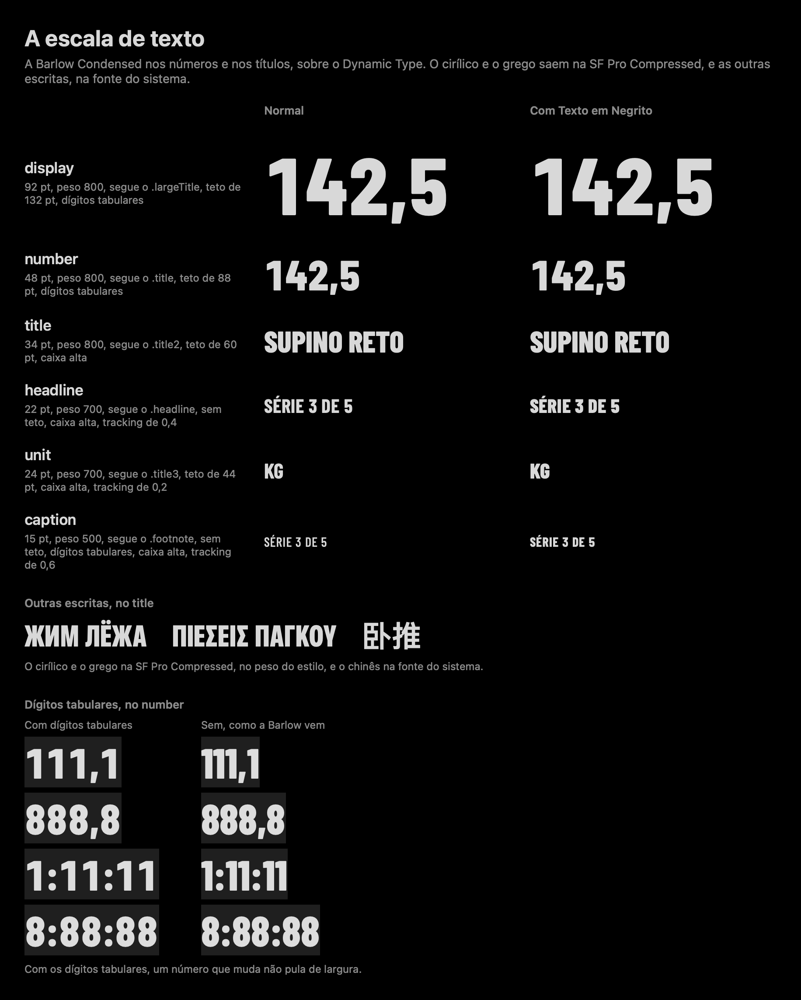
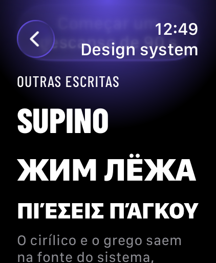
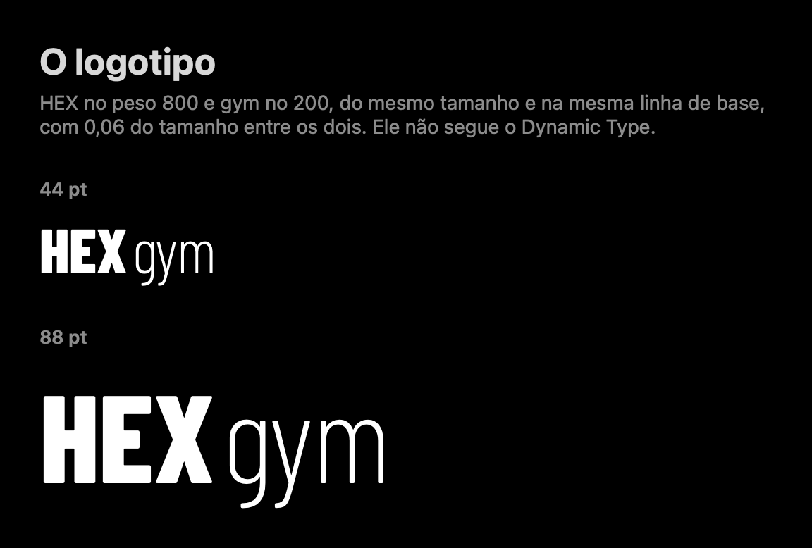

# A tipografia

A Barlow Condensed nos números, nos títulos e no logotipo; a SF Pro Compressed de reserva no cirílico e no grego; e a fonte do sistema (SF Pro) no texto corrido e nas outras escritas. É a tipografia final da seção 10 do documento de design, aceita nas decisões visuais de 03/11/2026.



No código: `Type/HexFonts.swift`, `Type/HexTextStyle.swift`, `Type/HexCase.swift` e `Type/HexWordmark.swift`. Os testes estão em `TypeTests.swift`.

## A Barlow Condensed

O pacote leva quatro pesos, cada um num arquivo:

| Peso | `HexWeight` | Nome PostScript |
|---|---|---|
| 200 | `.extraLight` | `BarlowCondensed-ExtraLight` |
| 500 | `.medium` | `BarlowCondensed-Medium` |
| 700 | `.bold` | `BarlowCondensed-Bold` |
| 800 | `.extraBold` | `BarlowCondensed-ExtraBold` |

- **O registro:** os quatro arquivos são registrados no processo (`CTFontManagerRegisterFontURLs`) na primeira vez que o pacote pede uma fonte. O `HexFonts.register()` pode ser chamado de novo sem efeito.
- **O cache:** `HexFonts.font(_:size:tabularDigits:)` guarda as fontes que já fez, porque o `body` das views pede a mesma fonte a cada mudança.

## A reserva para outras escritas

Os nomes dos exercícios vêm em 20 idiomas, e a Barlow só cobre o latim. Por isso cada fonte da marca leva uma cascata:

- **Cirílico e grego** saem na SF Pro Compressed (a fonte do sistema com largura `.compressed`), no peso equivalente: o 200 vira o thin, o 500 o medium, o 700 o bold e o 800 o heavy.
- **As outras escritas** (árabe, chinês, coreano, tailandês, hindi, bengali e as demais) saem na fonte do sistema daquela escrita, pela cascata do próprio CoreText. Nunca aparece um quadrado vazio: o teste `otherScriptsNeverShowAnEmptyBox` confere "ضغط البنش", "卧推", "벤치 프레스", "เบนช์เพรส", "बेंच प्रेस" e "বেঞ্চ প্রেস".
- **O latim**, incluindo os acentos do português, fica na Barlow.

A Barlow não tem cirílico, mas tem quatro letras gregas para a matemática: Δ, Ω, μ e π. Sem cuidado, o π de "πάγκου" sairia na Barlow, no meio de uma palavra na SF Pro Compressed. Por isso a fonte da marca tira da Barlow os blocos do grego e do cirílico do Unicode (`kCTFontCharacterSetAttribute`), e eles sempre saem na reserva. O efeito fora do grego é pequeno: um π ou um Ω solto num texto em latim também sai na SF Pro Compressed. O µ do Latin-1 (U+00B5) continua na Barlow.

O teste `cyrillicAndGreekFallBackToSFProCompressed` confere, nos quatro pesos, que "ЖИМ ЛЁЖА" e "Πιέσεις πάγκου" saem numa fonte que não é a Barlow, mais estreita que a normal e no peso de reserva, e que "SUPINO RETO" sai inteiro na Barlow.

**No Watch:** a fonte do sistema do watchOS é a SF Compact, e a reserva sai nela: no simulador do Watch, o teste `cyrillicAndGreekFallBackToSFProCompressed` passa nos quatro pesos, com as fontes `.SFCompact-Thin`, `-Medium`, `-Bold` e `-Heavy`, na largura comprimida (-0,3) e no peso de reserva exato. A galeria do Watch mostra "Supino", "ЖИМ ЛЁЖА" e "Πιέσεις πάγκου" no `title`.



**O grego em caixa alta:** a regra do grego tira o tonos das maiúsculas, e "Πιέσεις πάγκου" no `title` fica "ΠΙΕΣΕΙΣ ΠΑΓΚΟΥ". O `textCase` do SwiftUI, que o `hexFont` usa, põe em maiúsculas com o locale do ambiente: no iPhone e no Watch em português ou em inglês, ele deixa o tonos ("ΠΙΈΣΕΙΣ ΠΆΓΚΟΥ", achado no QA da PR #86 no Watch em pt-BR); só com o locale do grego ele tira. No Mac dos testes, em português e em inglês, ele tira (no turco, não), e por isso o print da escala já mostrava o grego sem o tonos. Para o texto que pode vir em grego (o nome de um exercício, por exemplo), o pacote tem o `HexText(_:style:)`: num estilo em caixa alta, ele põe o texto em maiúsculas pelo `HexCase.uppercased(_:locale:)`, que usa o locale do grego em cada trecho em grego e o locale de quem lê no resto (no turco, o i do latim continua virando İ). As duas galerias usam o `HexText` no exemplo em grego. Pôr em maiúsculas com o locale do próprio texto é uma escolha recomendada, com a delegação do Lipe de 03/11/2026 (#121). Os testes `greekCapitalsDropTheTonos` e `theHexTextShowsGreekCapitalsWithoutTheTonos` passam no Mac e no simulador do Watch.

## O texto corrido

O texto corrido (descrições, datas, listas, ajustes) não usa a escala da marca. Ele fica nos estilos do sistema (`.body`, `.subheadline` e os outros), na SF Pro, como a camada "Da Apple, como vem".

## A escala

Seis estilos, cada um seguindo um estilo de texto do sistema no Dynamic Type. Use com `.hexFont(_:)`:

```swift
Text(verbatim: "142,5").hexFont(.number)
```

| Estilo | Tamanho | Peso | Segue | Teto | Dígitos tabulares | Caixa alta | Espaço entre letras |
|---|---|---|---|---|---|---|---|
| `display` | 92 pt | 800 | `.largeTitle` | 132 pt | sim | não | 0 |
| `number` | 48 pt | 800 | `.title` | 88 pt | sim | não | 0 |
| `title` | 34 pt | 800 | `.title2` | 60 pt | não | sim | 0 |
| `headline` | 22 pt | 700 | `.headline` | sem teto | não | sim | 0,4 pt |
| `unit` | 24 pt | 700 | `.title3` | 44 pt | não | sim | 0,2 pt |
| `caption` | 15 pt | 500 | `.footnote` | sem teto | sim | sim | 0,6 pt |

O tamanho é o do tamanho de texto padrão (Large). O `.hexFont(_:)` é um modificador com `@ScaledMetric`: o tamanho cresce e diminui com o Dynamic Type, relativo ao estilo do sistema da coluna "Segue". Um estilo sem caixa alta deixa como está a caixa que vem de fora.

O teste `theScaleMatchesTheTable` confere os tamanhos, os tetos e quais estilos têm dígitos tabulares.

## Os tetos

Os estilos com teto são os de uma linha só (`display`, `number`, `title` e `unit`), que estourariam a tela no maior tamanho de texto (AX5). Eles crescem com o Dynamic Type até o teto e param ali. O `headline` e o `caption` quebram linha e crescem sem teto.

O teste `oneLineStylesStopAtTheirCap` confere: o `display` pedido em 400 fica em 132, pedido em 100 fica em 100, e o `headline` pedido em 400 fica em 400.

No Mac o Dynamic Type não muda o tamanho, então os testes do pacote conferem a escala como uma conta. No simulador do iPhone, os testes `DynamicTypeTests` do app conferem a escala de verdade: o `display` cresce no AX5 e para no teto de 132 pt, o `headline` passa de 1,5 vez a altura do tamanho padrão, e o Texto em Negrito deixa o texto mais largo. Os prints da galeria no AX5 estão em [prints/64](../prints/64/13-ax5-tipografia.png).

## Os dígitos tabulares

Os dígitos da Barlow são proporcionais: o 1 é mais estreito que o 8. Nos estilos `display`, `number` e `caption`, a fonte liga o recurso OpenType `tnum`, e todo dígito tem a mesma largura. Assim um número que muda (a carga, o tempo do descanso) não pula de largura, e 59:59 virando 1:00:00 não muda o tamanho de nada.

O teste `tabularStylesKeepEveryDigitTheSameWidth` confere que, com `tnum`, "111,1" e "888,8" têm a mesma largura, e "1:11:11" e "8:88:88" também; e que, sem ele, a diferença passa de 1 pt.

## O Texto em Negrito

Com o Texto em Negrito ligado no aparelho, cada estilo sobe um peso:

| Peso | Com Texto em Negrito |
|---|---|
| 200 | 500 |
| 500 | 700 |
| 700 | 800 |
| 800 | 800 |

O 800 é o peso mais forte que o pacote leva, então os estilos que já estão nele (`display`, `number` e `title`) ficam iguais. O teste `boldTextRaisesOneWeight` confere a tabela.

## O logotipo



O `HexWordmark` escreve HEX no peso 800 e gym no 200, do mesmo tamanho e alinhados pela linha de base, com 0,06 do tamanho entre os dois, em branco.

```swift
HexWordmark()            // 44 pt
HexWordmark(size: 88)
```

- O logotipo não segue o Dynamic Type nem o Texto em Negrito.
- O VoiceOver lê um elemento só: "HexGym". O rótulo é escrito com `Text(verbatim:)`, para o nome da marca não passar pela tradução.
- O gym no peso 200 é uma escolha recomendada, com a delegação do Lipe de 03/11/2026.

## A licença

A Barlow Condensed é da The Barlow Project Authors e usa a **SIL Open Font License 1.1** (OFL). A licença permite levar a fonte dentro do app, desde que o texto dela vá junto.

- **O texto da licença** está no pacote, em `apple/Packages/HexDesign/Sources/HexDesign/Resources/Fonts/OFL.txt`, ao lado das fontes. O teste `registersTheFourWeightsAndShipsTheLicense` confere que ele vai no pacote e diz "SIL OPEN FONT LICENSE Version 1.1".
- **De onde vieram os arquivos:** do repositório `google/fonts`, pasta `ofl/barlowcondensed/`, no commit `60824dce48f7dd28fe7d65559f2da1f6e04e585b` (26/02/2026), um commit fixado. Cada arquivo foi conferido pelo tamanho e pelo `git hash-object`:

| Arquivo | Bytes | `git hash-object` |
|---|---|---|
| `BarlowCondensed-ExtraLight.ttf` | 101172 | `f9f862c33c697c7b8f87de4ddf42fb0e2b942496` |
| `BarlowCondensed-Medium.ttf` | 103360 | `eee49eb632153608c0bef5809ceab2418dd617a8` |
| `BarlowCondensed-Bold.ttf` | 109912 | `9e480f467d703009e3abfce290b2ec2b7d24e188` |
| `BarlowCondensed-ExtraBold.ttf` | 110296 | `d5a6c7505459f142b20d65d3579e1b840462b75f` |
| `OFL.txt` | 4377 | `2f22ba6ca4dbc12145ae40b14c3368f387cba0e2` |

A SF Pro e a SF Pro Compressed são as fontes do sistema da Apple e não vão no pacote.
